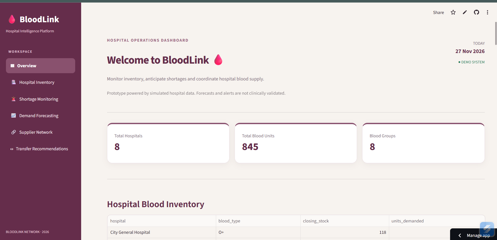

# BloodLink Network

**BloodLink Network is an AI-assisted hospital blood-inventory monitoring and coordination prototype.** It forecasts blood demand, identifies potential shortages, recommends nearby hospitals with projected surplus, and supports simulated transfer-request decisions with email and WhatsApp notifications.

  <a href="https://bloodlink-network-t5darcmvftlnma3pdijun8.streamlit.app/"><strong>Live Dashboard</strong></a> ·
  <a href="https://bloodlink-network.onrender.com/docs"><strong>API Documentation</strong></a> ·
  <a href="https://bloodlink-network.onrender.com/health"><strong>API Health</strong></a>

> **Demo-data and safety notice:** BloodLink uses synthetic hospital inventory data for eight simulated hospitals across Hyderabad, Vijayawada, and Guntur. It does not connect to real hospital systems, process patient data, execute blood transfers, or provide clinically validated recommendations. Transfer requests, approvals, rejections, and notifications are simulated workflow events—not operational hospital instructions.

## Overview

BloodLink brings together demand forecasting, inventory-risk analysis, supplier matching, and a human-reviewed coordination workflow.

The forecasting agent uses historical demand, lag features, rolling averages, hospital metadata, and blood-group information to estimate demand and project inventory over a seven-day horizon. The matching agent identifies forecasted shortages, finds hospitals with projected surplus, ranks candidates by distance, and allocates available projected surplus without reusing the same units.

The coordination agent turns recommendations into transfer requests that can be reviewed through the API. Decisions are stored in SQLite. After an approval or rejection is saved, BloodLink attempts to send an email and WhatsApp notification to the configured recipient.

## Workflow

~~~mermaid
flowchart TD
    A["Synthetic hospital inventory data"] --> B["Data preparation and time-series features"]
    B --> C["Random Forest demand forecasting"]
    C --> D["Seven-day inventory projection"]
    D --> E["Shortage-risk detection"]
    D --> F["Projected supplier surplus"]
    E --> G["Distance-aware supplier matching"]
    F --> G
    G --> H["Transfer recommendations"]
    H --> I["Coordination agent"]
    I --> J["Pending transfer requests"]
    J --> K["Human approval or rejection through API"]
    K --> L["SQLite decision persistence"]
    L --> M["Email notification"]
    L --> N["WhatsApp notification"]
    H --> O["FastAPI backend"]
    O --> P["Streamlit dashboard"]
~~~

## Live Demo

| Component | Link |
|---|---|
| Streamlit dashboard | [Open BloodLink](https://bloodlink-network-t5darcmvftlnma3pdijun8.streamlit.app/) |
| FastAPI service | [Open API](https://bloodlink-network.onrender.com/) |
| Interactive API docs | [Swagger UI](https://bloodlink-network.onrender.com/docs) |
| Health check | [API health](https://bloodlink-network.onrender.com/health) |

The links above refer to the currently deployed application. The coordination, SQLite, email, and WhatsApp work documented below is developed and tested on the `feature/coordination-and-alerts` branch; it should not be assumed to be present in the live deployment until that branch is reviewed, merged, and deployed.

## Features

### Forecasting and inventory analysis

- Synthetic dataset generator for 90 days of daily inventory activity across 8 simulated hospitals and 8 blood groups.
- Random Forest regression model for demand forecasting, using chronological train/test splitting.
- Time-series features including previous-day and previous-week demand, rolling 7-day and 14-day averages, day of week, and hospital metadata.
- Seven-day demand and projected-inventory calculations.
- Safety-stock calculations and shortage-risk identification.

### Supplier matching

- Supplier discovery using projected surplus inventory.
- Haversine-distance calculation and nearest-supplier ranking, with a 300 km matching limit.
- Greedy whole-unit transfer allocation that updates remaining projected surplus to avoid allocating the same units more than once.

### Coordination and notifications

- Coordination agent creates transfer-request records from supplier-matching recommendations.
- Request lifecycle supports pending review, simulated approval, and rejection.
- Decision notes and timestamps are stored with each request.
- SQLite persistence keeps coordination decisions across local API process restarts.
- Email notifications are attempted after a decision is saved.
- WhatsApp notifications are attempted after a decision is saved, using the Twilio WhatsApp Sandbox during development.
- Notification failures are handled separately so an email or WhatsApp delivery issue does not undo a saved decision.

**Important:** The notification messages communicate simulated workflow status only. They do not confirm that blood has been reserved, dispatched, or transferred.

## Coordination API

Run the API and open [Swagger UI](https://bloodlink-network.onrender.com/docs) for the available routes and request schemas. On the coordination-enabled feature branch, the workflow includes:

| Operation | Route | Purpose |
|---|---|---|
| List transfer requests | `GET /coordination/requests` | Retrieve generated coordination requests and their statuses |
| Decide a transfer request | `POST /coordination/requests/{request_id}/decision` | Approve or reject a pending request and trigger notification attempts |

A successful decision returns the updated request, including its status, decision note, decision timestamp, and a `simulation_only` indicator. Example statuses include `APPROVED_SIMULATED` and `REJECTED`.

## Tech stack

- **Language:** Python
- **Data processing:** Pandas, NumPy
- **Machine learning:** scikit-learn, Random Forest Regressor
- **API:** FastAPI, Uvicorn
- **Dashboard:** Streamlit
- **Persistence:** SQLite
- **Notifications:** Gmail SMTP, Twilio WhatsApp API
- **Configuration:** python-dotenv
- **Deployment:** Render (API), Streamlit Community Cloud (dashboard)

## Repository structure

~~~text
bloodlink-network/
├── agents/
│   ├── forecast_agent.py          # Demand features, model training, forecasts and risk logic
│   ├── matching_agent.py          # Projected surplus, distance ranking and transfer allocation
│   └── coordination_agent.py      # Transfer requests, decisions and SQLite persistence
├── api/
│   └── main.py                    # FastAPI routes and notification integration
├── dashboard/
│   └── app.py                     # Streamlit dashboard
├── services/
│   ├── email_service.py           # Gmail SMTP notification service
│   └── whatsapp_service.py        # Twilio WhatsApp notification service
├── data/
│   └── hospital_blood_data.csv    # Generated synthetic inventory dataset
├── data_sim/
│   └── generate_data.py           # Synthetic dataset generator
├── docs/
│   └── images/
│       └── bloodlink-dashboard.png
├── .streamlit/
├── requirements.txt
└── README.md
~~~

The SQLite database is created locally at `data/coordination.db` when the coordination agent initializes. It is runtime data and should not be committed to Git.

## Run locally

Use Python 3.10+ and run commands from the repository root.

1. Clone the repository and enter the project folder:

   ~~~bash
   git clone https://github.com/AmishaSingh0408/bloodlink-network.git
   cd bloodlink-network
   ~~~

2. Check out the coordination and notifications branch if you want to run those features:

   ~~~bash
   git checkout feature/coordination-and-alerts
   ~~~

3. Create and activate a virtual environment (Windows PowerShell):

   ~~~powershell
   python -m venv venv
   .\venv\Scripts\Activate.ps1
   ~~~

   On macOS/Linux, activate it with `source venv/bin/activate`.

4. Install dependencies:

   ~~~bash
   pip install -r requirements.txt
   ~~~

5. Generate the synthetic dataset (this overwrites `data/hospital_blood_data.csv`):

   ~~~bash
   python data_sim/generate_data.py
   ~~~

6. Configure notification credentials if you want to test email and WhatsApp. Create a root-level `.env` file using the variable names below. **Never commit this file or share its secret values.**

   ~~~dotenv
   SMTP_EMAIL=your_sender_email
   SMTP_APP_PASSWORD=your_email_app_password
   ALERT_RECIPIENT=recipient_email

   TWILIO_ACCOUNT_SID=your_twilio_account_sid
   TWILIO_AUTH_TOKEN=your_twilio_auth_token
   TWILIO_WHATSAPP_NUMBER=whatsapp:+your_sandbox_number
   TWILIO_WHATSAPP_RECIPIENT=whatsapp:+your_joined_number
   ~~~

   For Gmail SMTP, use an app password where required by your Google account settings; do not use your normal account password. For WhatsApp development testing, configure a Twilio WhatsApp Sandbox and join the sandbox from the recipient WhatsApp account. Keep all credentials private. If notification credentials are not configured, notification delivery will not work; the API decision workflow is designed to preserve the saved decision even if a notification attempt fails.

7. Start the API in one terminal:

   ~~~bash
   uvicorn api.main:app --reload
   ~~~

8. In a second terminal, start the dashboard:

   ~~~bash
   streamlit run dashboard/app.py
   ~~~

   The dashboard's configured API URL currently points to the deployed Render backend. To use the local API instead, change `API_URL` in `dashboard/app.py` to `http://127.0.0.1:8000` before starting Streamlit.

9. Open the local dashboard at [http://localhost:8501](http://localhost:8501) and API docs at [http://127.0.0.1:8000/docs](http://127.0.0.1:8000/docs).

## Testing the coordination workflow

1. Start the API from the coordination-enabled branch.
2. Open the local Swagger UI at `http://127.0.0.1:8000/docs`.
3. Use `GET /coordination/requests` to retrieve pending requests.
4. Choose a request with `PENDING_APPROVAL` status.
5. Use `POST /coordination/requests/{request_id}/decision` with a decision body such as:

   ~~~json
   {
     "decision": "APPROVE",
     "note": "Approved for integration testing"
   }
   ~~~

   Use `REJECT` to test the rejection path.
6. Confirm the response status is `APPROVED_SIMULATED` or `REJECTED`, then check the configured email and WhatsApp recipient inboxes.

A request can only be decided while it is pending. Use separate pending requests to test approval and rejection. Notification delivery depends on valid local credentials and, for WhatsApp, an active Twilio Sandbox join.

## Model evaluation

The forecasting code evaluates the Random Forest model with a chronological 80/20 date-based train/test split and reports Mean Absolute Error (MAE) in blood units. Run:

~~~bash
python -m agents.forecast_agent
~~~

This prints the measured MAE along with training/test row counts and a sample seven-day forecast. A verified MAE value and a like-for-like baseline comparison have not yet been recorded in this README, so no performance-improvement claim is made here. Add measured values after running an evaluation on the committed dataset with the same chronological test period.

## Screenshots

The screenshot below shows the dashboard overview. Displayed figures are generated from the project's synthetic demo dataset.

## Limitations and future work

- **Synthetic data:** Inventory and demand records are generated for demonstration and do not represent actual hospital stock.
- **Experimental forecasts:** Model outputs and supplier recommendations have not been clinically validated.
- **Simplified logistics:** Supplier distance uses static coordinates; road travel time, transport constraints, blood-component compatibility rules, expiry, cold-chain logistics, and operational approvals are not modeled.
- **Simulated decisions:** Approving a request changes its workflow status only. It does not reserve, dispatch, or transfer blood.
- **Local SQLite storage:** The coordination database persists across local API restarts, but a deployment needs durable persistent storage configured for the database file. An ephemeral hosting filesystem may lose database contents when an instance is replaced or restarted.
- **Notification scope:** Email and WhatsApp notifications are integration tests for configured recipients, not connections to hospital communication systems. Twilio Sandbox is intended for development/testing.
- **Production readiness:** Live hospital integrations, access control, audit/security review, monitoring, clinical validation, regulatory review, and production-grade reliability are outside the current prototype.

## Author

**Amisha Singh**  
[GitHub](https://github.com/AmishaSingh0408)

---

If you find the project useful, feel free to explore the code and open an issue with feedback.
